<p align="center">
  
</p>

<h3 align="center">One calm place to run a healthcare business.</h3>

<p align="center">
  A multi-vendor healthcare SaaS. Hospitals, clinics, laboratories, pharmacies, blood banks, ambulance services and 14 other kinds of care provider each get their own <b>public website</b>, their own <b>staff portal</b> and a <b>subscription plan</b>, all run from one platform.<br>
  Plain PHP, plain CSS, plain JavaScript. No framework, no packages, no build step.
</p>

<p align="center">
  <a href="docs/INSTALL.md">Install</a> ·
  <a href="docs/DEPLOY.md">Deploy</a> ·
  <a href="docs/ARCHITECTURE.md">Architecture</a> ·
  <a href="docs/ROLES.md">Roles and access</a> ·
  <a href="docs/vendor-types.md">Vendor types</a> ·
  <a href="https://selfcare.easybzi.com">Live demo</a>
</p>

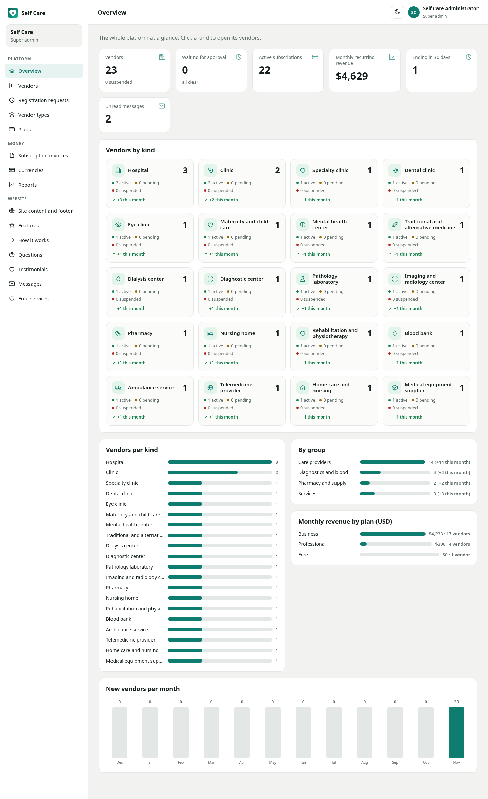

---

## What is in it

| Area | What you get |
| --- | --- |
| **Public site** | Landing page, pricing, provider directory, free services, registration, sign in, forgot password |
| **Vendor website** | One site per vendor at `name.yourdomain.com` (or its own custom domain), built from the vendor's type: services, doctors, tests, fleet, FAQ, gallery, news, request form |
| **Vendor portal** | Overview with charts, requests queue (approve, reject with a reason, cancel), staff and roles, team and people lists, invoices, printed forms, reports, stock, website editor, custom domains |
| **Super admin** | Overview of every vendor type, vendor profiles, add / edit / suspend / soft-delete / restore / purge vendors, registration approvals, "Open portal" impersonation (audited), plans, platform invoices, currencies, site content |
| **Access control** | 44 roles, least privilege per vendor type, time-boxed and shift-based access, full audit log of every permission change |
| **Money** | Plans and subscriptions, invoices, receipts, credit notes, PDF output, amount in words, nine currencies (PKR, BDT, USD, INR, CAD, EUR, GBP, AED, SAR) with per-vendor currency |
| **Safety** | CSRF on every form, throttled sign-in, password-set links, one-time hand-off tokens between hosts, soft delete with typed confirmation |

### 20 vendor types

Hospital · Clinic · Specialty clinic · Dental clinic · Eye clinic · Maternity and child care · Mental health center · Traditional and alternative medicine · Dialysis center · Diagnostic center · Pathology laboratory · Imaging and radiology center · Pharmacy · Nursing home · Rehabilitation and physiotherapy · Blood bank · Ambulance service · Telemedicine provider · Home care and nursing · Medical equipment supplier.

Each type belongs to a *family* (clinical, diagnostics, pharmacy, bloodbank, ambulance, residential, equipment …). A family is one website template plus one portal template; see [docs/vendor-types.md](docs/vendor-types.md).

## Screenshots

| | |
| --- | --- |
| 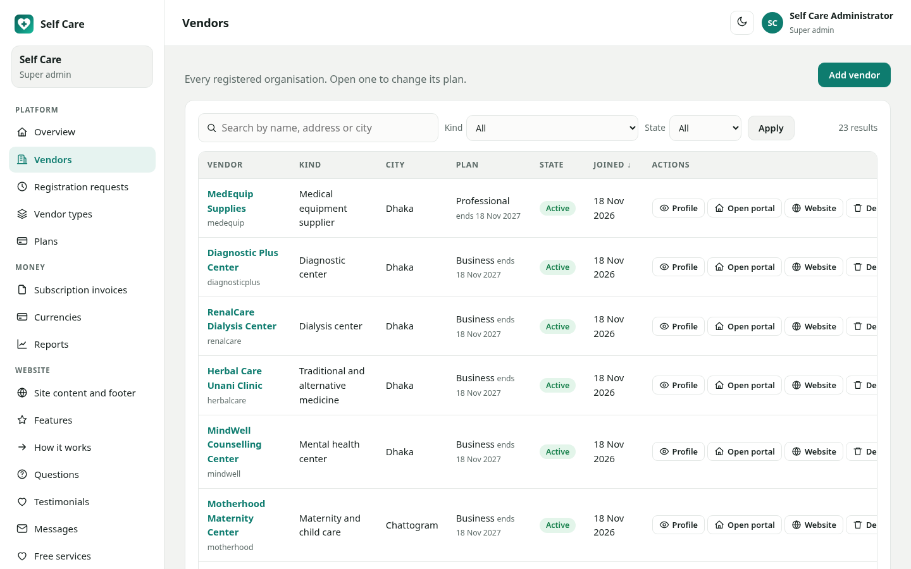 <br> **Vendors** — every organisation, add and manage | 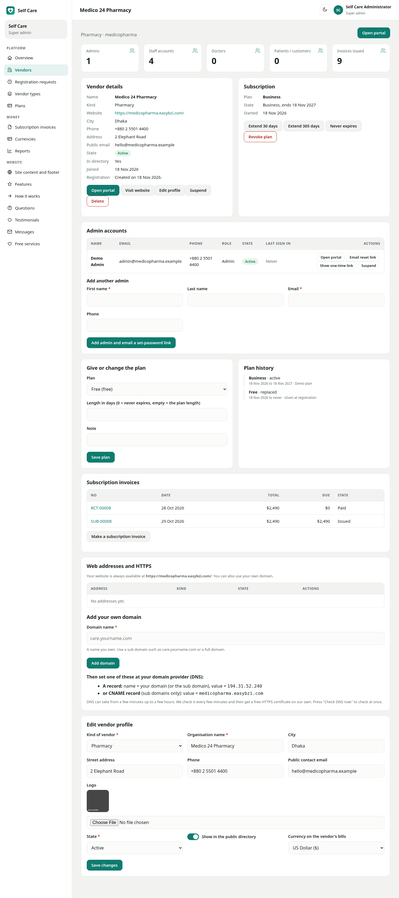 <br> **Vendor profile** — admins, plan, invoices, domains |
| 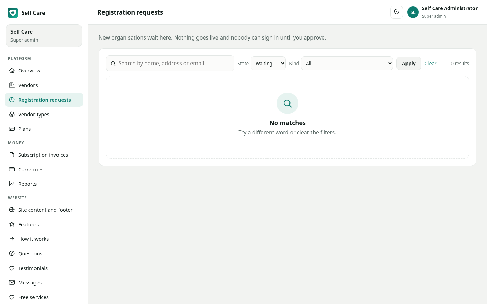 <br> **Registration requests** — approve, reject, cancel | 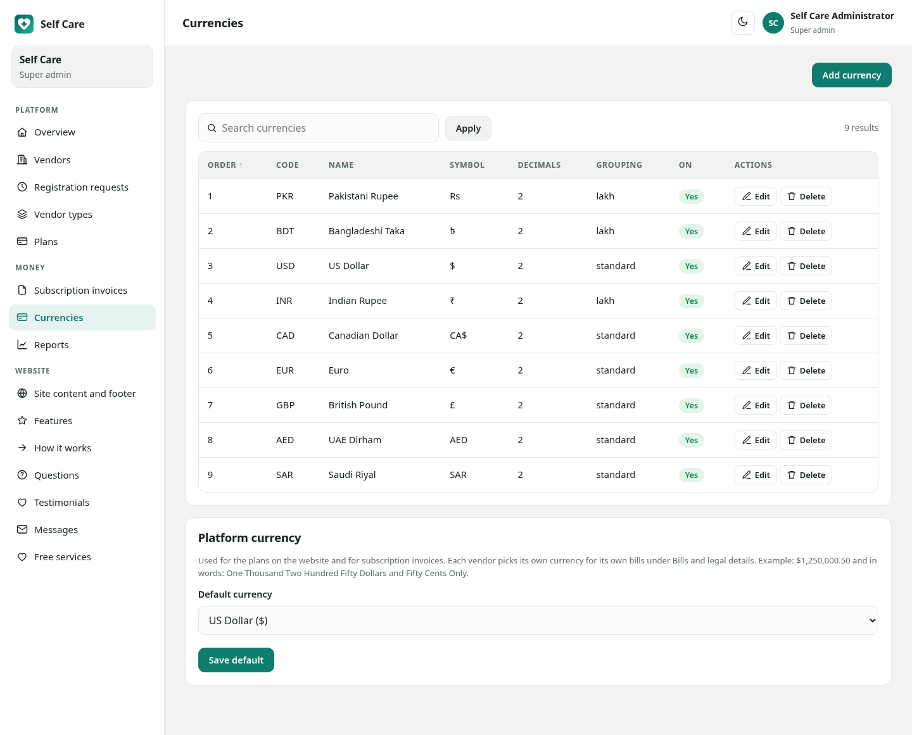 <br> **Currencies** — platform default and per-vendor |
| 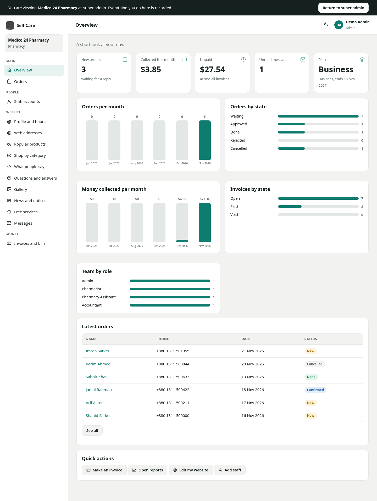 <br> **Open portal** — super admin inside a vendor, with return banner | 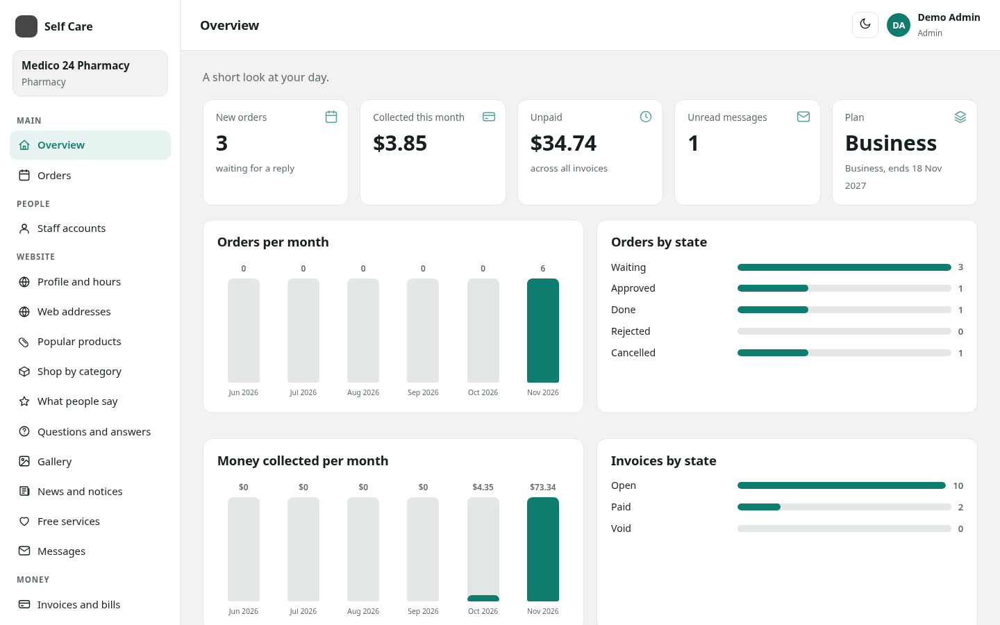 <br> **Pharmacy portal** overview |
| 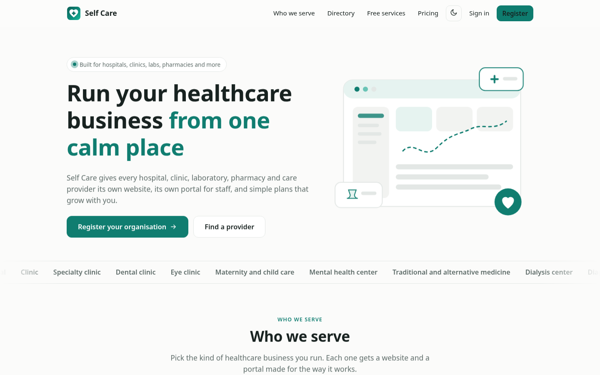 <br> **Landing page** | 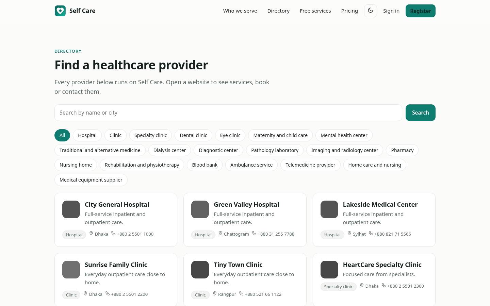 <br> **Provider directory** |
| 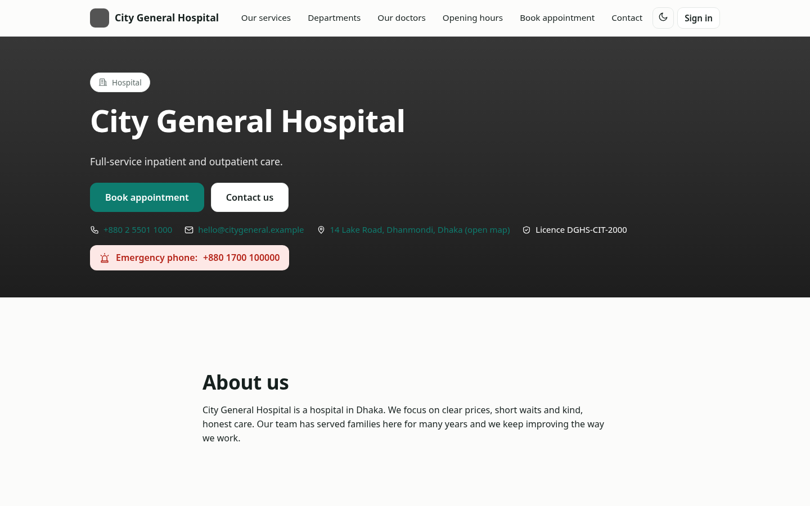 <br> **Hospital website** | 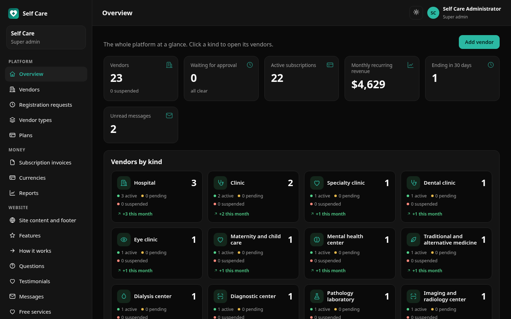 <br> **Solid dark mode** |

Phones are first-class: tables become cards under 700 px.

<p align="center">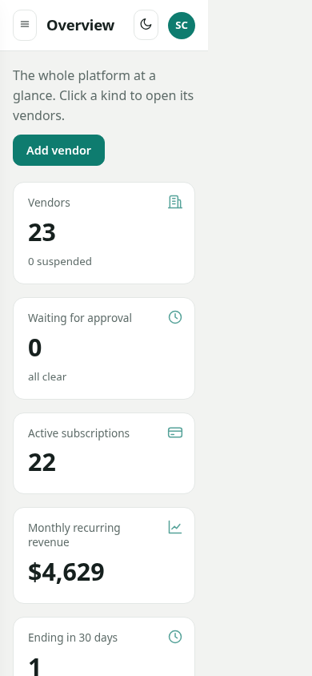</p>

## How it fits together

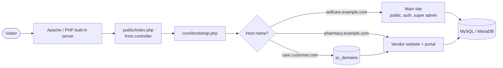

The host name decides which vendor you are talking to (**tenancy by host**). Every vendor row, user, invoice, request and setting carries a `tenant_id`, and every query filters on it.

### Tenant and signup flow

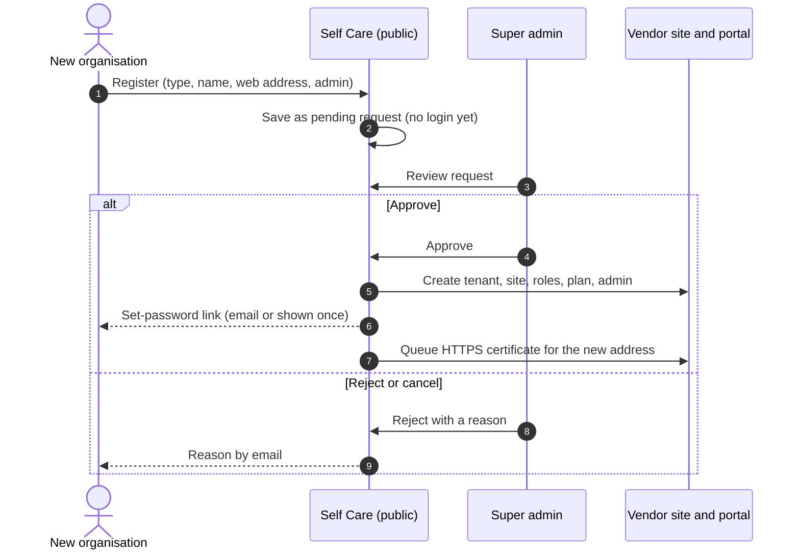

### Roles and access

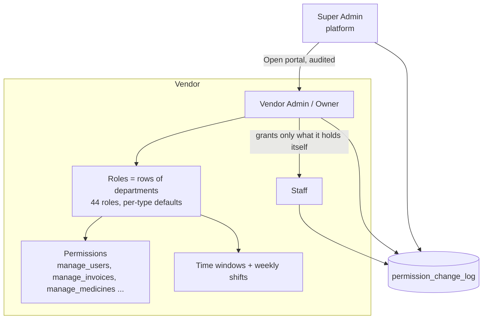

Details: [docs/ROLES.md](docs/ROLES.md).

## Quick start

```bash
git clone https://github.com/arifuzzamanraihan/Selfcare.git
cd Selfcare
cp .env.example .env              # edit DB_* (and TENANT_SUFFIX / MAIN_HOST for vendor subdomains)
php database/phase1/install.php   # creates tables, seeds vendor types, plans and currencies
php database/phase1/seed-demo.php --creds=/tmp/selfcare-credentials.txt   # optional demo vendors
php -S 127.0.0.1:8080 -t public bin/router.php
```

Open <http://127.0.0.1:8080>. Full guide, including subdomains on localhost: [docs/INSTALL.md](docs/INSTALL.md).

Requirements: PHP 8.1+ (`pdo_mysql`, `mbstring`, `openssl`, `gd`, `curl`, `fileinfo`, `intl`), MySQL 5.7+ or MariaDB 10.x. No Composer, no npm.

## Repository layout

```text
core/            application code (router, auth, access, tenancy, billing, PDF, listing, charts, currency ...)
  routes/        public · auth · site · portal · admin · documents
  config/        vendor types, roles, permissions, document catalogue
templates/       PHP views (public site, vendor sites, dashboards)
public/          web root: index.php, css/, js/, img/, uploads/
database/phase1/ install.php, schema.sql, migrations, demo seeder
bin/             router.php (dev server), ssl-worker.php (HTTPS automation)
docs/            guides, branding, screenshots
legacy/laravel/  the original Laravel-era code, kept for reference only. Not executed.
```

## Documentation

| Guide | |
| --- | --- |
| [INSTALL](docs/INSTALL.md) | Run it on your machine |
| [DEPLOY](docs/DEPLOY.md) | Production: Apache, wildcard host, HTTPS automation, backups |
| [ARCHITECTURE](docs/ARCHITECTURE.md) | Request lifecycle, modules, data model, security |
| [ROLES](docs/ROLES.md) | Roles, permissions, impersonation, audit |
| [Vendor types](docs/vendor-types.md) | The 20 types and their families |
| [Documents and reports](docs/documents-and-reports.md) | Invoices, forms, reports, PDFs |
| [UI system](docs/ui-system.md) | Listing, Crud and dashboard components |
| [Platform guide](docs/platform-guide.md) | Plans, subscriptions, site content |
| [Project status](docs/STATUS.md) | What is done per vendor type, and what is next |

## Licence

Proprietary. © 2026 Selfcare. All rights reserved. See [LICENSE](LICENSE).
