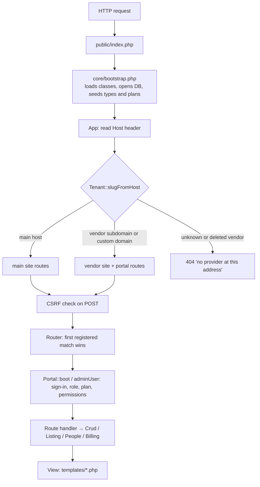
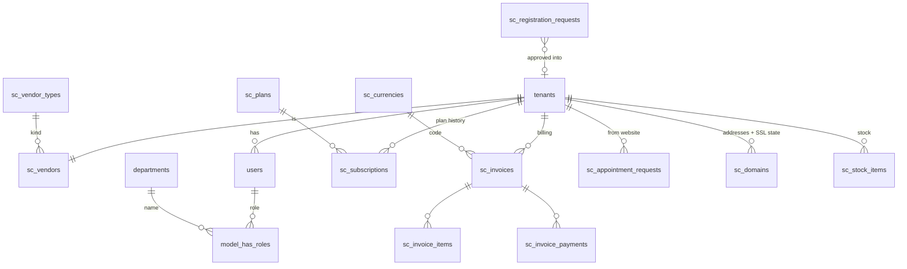

# Architecture

Self Care is a small, framework-free PHP application. Everything lives in the `Selfcare` namespace under `core/`.

## Request lifecycle

## Modules

| File | Job |
| --- | --- |
| `Tenant`, `Domains` | Host → vendor, subdomains, custom domains, DNS check, certificate queue |
| `Auth`, `Throttle` | Sign-in, sessions, password-set links, hand-off tokens between hosts, impersonation |
| `Access` | Roles (`departments`), permissions, per-vendor overrides, time windows, audit log |
| `Plans`, `Billing`, `Currency` | Subscriptions, invoices and payments, money formatting and amount in words |
| `Vendors`, `VendorTypes` | Create, soft delete, restore, purge vendors; type and family templates |
| `Portal`, `People` | One portal request (who, which vendor, nav); staff and people management |
| `Listing`, `Crud`, `Charts` | Reusable table, form and chart components (`docs/ui-system.md`) |
| `Documents`, `Pdf`, `Reports` | Printed forms, invoice PDFs, reports |
| `routes/*.php` | `public`, `auth`, `site`, `portal`, `admin`, `documents` |

## Data model (main tables)

`tenant_id` is on every vendor-owned row. Platform-level audit entries use the pseudo tenant `_platform`.

## Security notes

- **CSRF**: every POST is checked; every form carries a token.
- **Passwords**: bcrypt; reset and set-password links are random 256-bit tokens, stored as SHA-256, valid 7 days, single use.
- **Cross-host sign-in**: a 60-second, single-use token (`sc_login_tokens`) carries a session from the main host to a vendor host. The browser is sent through a small HTML hop page because the Content-Security-Policy blocks a POST redirecting to another host.
- **Impersonation** ("Open portal"): the token records the super admin; the vendor portal shows a banner and `Return to super admin`; entry and exit are written to the audit log; it does not touch the vendor user's last-login time.
- **Soft delete**: vendors and users get `deleted_at`; deleted vendors answer 404 and their users cannot sign in. Purge needs two typed confirmations.
- **Least privilege**: a user can only grant roles whose permissions they hold; only an admin can edit another admin; the last active admin cannot be removed.
- **Content-Security-Policy** and other security headers are sent on every response.
